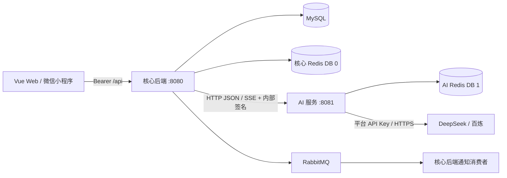

# 健康管理系统：架构与技术实现

项目采用核心业务后端与独立 AI 服务的双进程架构。核心后端负责身份认证、数据授权、业务事务和通知调度；AI 服务负责模型调用、Prompt 与知识检索。Web 和微信小程序统一访问核心后端，模型由平台统一提供，普通用户按月付费，管理员免费。

## 架构与服务边界



| 模块 | 技术与职责 | 代码入口 |
| --- | --- | --- |
| 核心后端 | Java 17、Spring Boot 3.1、Spring Security、MyBatis-Plus、Flyway | [`backend/`](backend/) |
| AI 服务 | 独立 Maven 工程、LangChain4j 1.17、供应商适配、SSE | [`ai-service/`](ai-service/) |
| Web | Vue 3、Pinia、Axios、Element Plus、ECharts；认证刷新与并发冲突处理 | [`frontend/`](frontend/) |
| 小程序 | 原生微信客户端；凭据刷新、分块流式响应 | [`miniprogram/`](miniprogram/) |
| 基础设施 | MySQL 8、Redis、RabbitMQ、Nginx、Docker Compose | [`docker-compose.yml`](docker-compose.yml) |

AI 服务不依赖核心后端 JAR，不连接业务 MySQL，也不持有用户登录签名密钥或数据库密钥加密主密钥。健康数据查询与授权、聊天历史保存、预约确认及写入都在核心后端完成。通知消费者仍属于核心后端。

当前服务间调用使用 Java `HttpClient`，地址由 `AI_SERVICE_URL` 配置，本地为 `http://127.0.0.1:8081`，Compose 内为 `http://ai-service:8081`；未引入 Spring Cloud 注册中心、OpenFeign、gRPC 或 Dubbo。

## 身份认证与会话撤销

认证由短期 Access JWT 与 Redis 设备会话共同决定，不能通过传入 `userId` 或仅通过 JWT 签名校验取得权限。

- Access Token 默认有效期 15 分钟，校验签名、签发者、接收者、类型与 `sid`。后端继续验证会话状态、用户启用状态、撤销版本及密码/角色指纹，权限角色取数据库当前值。
- 每台设备有独立刷新凭据，Redis 仅存 SHA-256 摘要。Lua 原子校验并轮换凭据；重用已消费的刷新凭据会撤销对应设备会话，猜错凭据不会直接删除会话。会话默认绝对寿命 7 天，刷新不延长。
- 改密码、禁用账号、强制下线递增撤销版本，使旧设备会话失效；认证存储不可用返回 HTTP 503，不绕过校验。
- Web Access Token 保存在内存；刷新凭据使用 HttpOnly Cookie，生产启用 Secure、SameSite=Strict。登录、刷新、退出使用 CSRF 校验；业务 API 与聊天流显式携带 Bearer Token。
- Web 用共享 Promise 合并同页刷新，Web Locks 串行化多标签页刷新；小程序使用独立原生刷新接口并合并并发刷新。网页和原生刷新凭据不能互换。

业务接口从认证上下文确定操作人，再校验资源归属或授权关系。聊天原文及检查点在 MySQL 中按认证用户隔离，按完整请求预算触发模型摘要；设备登录会话与用户聊天历史分别管理，同一账号的聊天历史按用户共享。

实现：[`JwtAuthenticationFilter`](backend/src/main/java/com/health/common/filter/JwtAuthenticationFilter.java)、[`AuthSessionService`](backend/src/main/java/com/health/service/AuthSessionService.java)、[`认证 Lua`](backend/src/main/resources/auth/)。

## 数据授权与并发一致性

### 健康记录乐观锁

健康记录使用 MyBatis-Plus `@Version`。客户端提交读取时的版本号，更新同时匹配 ID、未删除状态与旧版本，成功后递增版本：

```sql
-- 更新条件的等价示意，其他业务字段省略
UPDATE health_record
SET notes = ?, version = version + 1
WHERE id = ? AND deleted = 0 AND version = ?;
```

旧版本、并发修改或删除导致匹配失败时返回 HTTP 409；缺少或非法版本返回 HTTP 400。Web 与小程序保留冲突表单、刷新列表，由用户核对最新记录后再次编辑，避免自动重试覆盖他人修改。

健康记录与关联历史记录的增删改处于同一事务，历史同步失败会回滚记录与版本。软删除也使用版本条件，只修改删除标记与版本。

实现：[`HealthRecordServiceImpl`](backend/src/main/java/com/health/service/impl/HealthRecordServiceImpl.java)、[`HealthRecordMapper`](backend/src/main/java/com/health/mapper/HealthRecordMapper.java)。

### 家庭授权关系

家庭共享采用邀请状态流转，只有双方确认后的 `ACTIVE` 关系可读取报告或发送提醒。按双方 ID 排序建立唯一关系，固定顺序锁定账号行处理双向邀请，关系行锁处理重复提醒与解绑竞争。

报告生成前后均校验关系，防止生成期间解绑后继续返回数据；共享权限不允许修改家人的健康记录。提醒状态仅由接收人修改，同类提醒有发送间隔限制。

实现：[`FamilyService`](backend/src/main/java/com/health/service/FamilyService.java)、[`V7 迁移`](backend/src/main/resources/db/migration/V7__add_family_members.sql)。

## AI 服务通信与付费权限

| 内部接口 | 用途 | 响应 |
| --- | --- | --- |
| `POST /internal/ai/complete` | 健康报告、预约字段提取、非流式调用 | JSON |
| `POST /internal/ai/stream` | 流式聊天 | SSE：`thinking`、`token`、`done`、`error` |

核心后端传输已授权的数据摘要、模板变量与必要历史，AI 返回文本或结构化结果。预约字段由模型提取，字段校验、补充与用户确认仍由核心后端处理，确认后才写业务数据库。

### 内部请求鉴权

每次请求由独立的 `AI_SERVICE_SECRET` 签发 HS256 JWT，有效期 60 秒，绑定用户 ID、请求体 SHA-256、调用类型和随机请求 ID。AI 服务验证签名、时间、issuer/audience、请求体摘要、接口类型及请求体用户 ID，再通过 Redis `SET NX` 记录请求 ID、拒绝重放。Redis 不可用时返回 503，拒绝继续调用模型。

这套凭证与用户登录 Token 分开。默认仅监听本机，Compose 不映射 AI 宿主机端口；服务间请求含平台模型 Key，签名不提供传输加密，跨主机部署需使用 HTTPS/mTLS 或加密私网。

### 平台模型与按月付费

- 平台通过 `AI_PLATFORM_API_KEY`、`AI_PLATFORM_PROVIDER` 和 `AI_PLATFORM_MODEL` 配置生成模型；公共知识向量使用独立的 `AI_EMBEDDING_API_KEY`。用户不再填写或承担向量模型账号的费用。
- Plus ¥9.9/月、Pro ¥19.9/月、Pro Max ¥29.9/月，目前功能相同。网页支持微信 Native 与支付宝当面付扫码，每笔订单一个自然月，不自动扣费。同档续费从现有到期时间顺延，到期后可换档。
- 普通用户仅在存在有效付费资格时可使用 AI。管理员豁免按数据库当前身份判断，禁用/删除账号不豁免。聊天、报告（含缓存）、预约提取、异步长期记忆任务在服务端校验；未付费返回 HTTP 402。
- `GET /api/ai/access` 返回当前认证用户的状态，不接受目标用户 ID。旧 `PUT/DELETE /api/ai/settings` 返回 403；历史 `user_ai_config` 保留但不再读取，避免破坏旧数据。
- 支付金额和套餐在后端确定；官方 SDK 验签、微信回调解密、金额/商户/应用校验、用户行锁、订单行锁和唯一流水约束共同保护开通。重复通知只处理一次，订单与资格同事务提交；后台独立线程主动查单补偿通知丢失。
- 小程序展示同一账号的套餐与使用资格，复制网页入口完成支付；本轮未接入小程序 JSAPI 直接支付。记忆查看/删除保持可用，不依赖付费。

部署参数、回调地址及验收步骤见 [AI 支付与平台模型配置](docs/ai-billing.md)。

### 用户长期记忆

聊天采用四层认知记忆：Redis 瞬时缓冲、Redis 工作上下文、MySQL 情景事件和 MySQL 语义事实。注意力编码筛选事件，后台回放巩固知识，关键词/向量/实体关联检索按当前问题召回，显式反馈调整策略，激活衰减控制归档。普通健康聊天原文和检查点由 V12 保存到 MySQL；完整请求预算达到 85% 时额外调用一次模型生成带来源的医疗检查点，保留连续近期原文，成功后总预算目标为窗口的 30%。压缩不删除原文，支持按问题回查；原文不受旧 Redis 的 7 天 TTL 控制。摘要无效时保留原状态，SSE 注释心跳保持既有聊天流程。预算使用 UTF-8 字节保守上界，可能提前触发，不能保证零幻觉或临床正确性。详见[聊天上下文压缩](docs/chat-context-compression.md)。长期记忆按认证用户隔离，默认启用，可在网页「AI 服务与记忆」中管理；关闭保留已有数据但停止提取和使用。

普通健康聊天回复成功后（SSE 在完整回复结束后），核心后端在事务中写入记忆 Outbox，再由 RabbitMQ 消费者调用平台模型，重新校验用户使用资格。`memory-extract-system.md` 抽取最多 8 条带原文、主体、重要性、实体和时间证据的候选。提取只使用当前用户消息及已有事实；后端先校验，再评分、保存情景事件和调度巩固。疑问、假设和主体识别依然可能发生语义误判，用户可在设置页纠正。预约专用流程不触发提取。

- 默认每账号最多 500 条语义知识、2000 条经历，容量可配置。按事实键与事件来源巩固，不从重复总结制造新证据。临时状态有效期 1–30 天，过期后仅能作为明确的历史经历召回。每次最多召回 8 条，并受上下文预算约束；未配置向量 Key 时使用关键词与实体关联。
- 明确改变习惯或目标时替代旧值；健康事实矛盾或含糊变化标记为 `CONFLICT`，保留原说法和新说法及其证据，用户确认前不注入长期上下文。记忆属于用户自述，不是医学诊断。
- 用户状态行锁、revision 和轮次序号约束并发写入；旧轮次不能覆盖更新的同一事实。修改、删除、清空和切换开关使旧任务失效，删除之后到达的模型结果不能恢复旧记忆。
- 修改、删除、清空或关闭时同时清除服务端 MySQL 原文和检查点、旧 Redis 最近对话，防止被遗忘的信息继续通过旧上下文传给模型。Redis 清除失败会让管理操作失败并回滚数据库修改。已开始的模型请求无法撤回，但其后续记忆写入会被拒绝。浏览器本地显示的对话历史单独管理，不会自动作为请求上下文上传；重新发送或重新生成旧消息可能再次提取其中的信息。
- 记忆提取与可选向量调用使用平台额度。Outbox、持久队列、工作租约和幂等写入支持重启恢复与有限重试，重试耗尽在页面显示失败数；模型调用在网络故障下可能重复发生。巩固使用确定性的带证据回放，不增加第二次聊天模型调用。已完成、取消和最终失败的任务清除原始输入。

| 接口 | 用途 |
| --- | --- |
| `GET /api/chat/memories` | 查看开关、有效记忆及待确认冲突 |
| `PUT /api/chat/memories/settings` | 设置 `{"enabled":true/false}` |
| `PUT /api/chat/memories/{id}` | 修改或确认 `{"content":"确认后的内容"}` |
| `DELETE /api/chat/memories/{id}` | 删除自己的指定记忆 |
| `DELETE /api/chat/memories` | 清空自己的全部记忆及服务端聊天原文和检查点 |

页面增加经历时间线、知识版本与证据、固定保留、最近召回反馈。删除事实会删除对应经历、版本和向量；删除单条经历会撤回依赖结论，并用剩余证据重新巩固。详细算法、任务状态机、接口、部署与评估说明见 [认知记忆实现过程](docs/cognitive-memory.md)。

仅普通聊天接入长期记忆，健康报告仍使用原有数据库档案及公共知识检索。核心后端启动自动执行 V11 认知记忆及 V12 聊天归档迁移，并保留旧事实。V12 需要两个 Java 服务同步更新，沿用现有前端协议。

实现：[`LongTermMemoryService`](backend/src/main/java/com/health/memory/LongTermMemoryService.java)、[`MemoryExtraction`](backend/src/main/java/com/health/memory/MemoryExtraction.java)、[`V9 迁移`](backend/src/main/resources/db/migration/V9__add_user_long_term_memory.sql)、[`记忆管理组件`](frontend/src/components/UserMemories.vue)。

## 报告缓存、知识检索与降级

### 数据指纹缓存

健康报告将用户资料、健康/运动/历史记录和平台 AI 配置 revision 纳入 SHA-256 指纹。缓存键同时区分目标用户与调用者，隔离不同查看者的报告缓存；每次读取缓存前仍检查查看者的付费资格。

数据与配置不变时复用报告；记录变化、更换模型或递增 `AI_PLATFORM_REVISION` 后指纹变化，重新生成。缓存保留每组目标用户与调用者的最新快照，不为每个 revision 新建键，也不设置时间过期。已授权用户遇到 AI 不可用、平台未配置或超时时返回规则分析，并用 `analysisSource=RULES` 标记；故障降级结果不写入长期报告缓存，恢复后可再次生成。

实现：[`SmartHealthServiceImpl`](backend/src/main/java/com/health/service/impl/SmartHealthServiceImpl.java)。

### 知识检索与 Prompt

服务端配置百炼向量 Key 后，在启动就绪时统一构建/恢复公共 Markdown 知识索引；未配置或故障时回退关键词检索。

- 知识内容和 embedding 模型共同决定公共索引命名空间，所有用户共享；每个 AI 实例长期复用一个内存索引，避免逐请求读取完整 JSON。
- Redis 保存完整向量及文本快照，内容不变时重启从快照恢复；不同知识版本可在滚动部署时并存。
- 重建锁自动续期；Lua 校验锁所有权后保存与释放，失去锁的实例无法覆盖快照。失败重建有一分钟冷却。
- 查询向量使用平台密钥生成。每用户保留最新查询一天，避免保留无限查询；进程内与 Redis 锁合并并发生成，拿不到锁时回退关键词检索，不绕过锁调用收费模型。
- 此公共索引仅包含平台知识文档，不混入个人健康记录、聊天或长期记忆。

向量快照存储在 Redis，实际相似度检索使用 JVM 内的 LangChain4j `InMemoryEmbeddingStore`。Prompt 使用独立 Markdown 模板，支持外部覆盖，启动时加载并检查模板变量。

实现：[`KnowledgeService`](ai-service/src/main/java/com/health/ai/KnowledgeService.java)、[`HealthKnowledgeRedisRepository`](ai-service/src/main/java/com/health/ai/HealthKnowledgeRedisRepository.java)、[`PromptService`](ai-service/src/main/java/com/health/ai/PromptService.java)。

## 流量保护与资源上限

入口保护在 JWT 校验和业务查库前执行，分为共享速率限制与实例并发限制：

| 层级 | 实现 | 默认行为 |
| --- | --- | --- |
| 全局速率 | Redis Lua 令牌桶，使用 Redis 时钟原子补充与扣减 | 所有实例共用桶，50 请求/秒，容量 50 |
| 实例并发 | 非阻塞 `Semaphore.tryAcquire()` | 每实例 16 个 API 请求，超出返回 429 |
| SSE 生命周期 | `AsyncListener` 跟踪异步请求 | 完成时释放额度，超时/错误不提前释放 |
| 个人限流 | `@RateLimit` + AOP + Redis 固定窗口 | 按用户或 IP 对指定接口限制 |
| AI 调用 | 主后端调用槽位、有界流式线程池与 AI 服务并发上限 | 两端默认各 8 个模型调用槽位，超载快速失败 |

全局限流 Redis 故障返回 503，拒绝放行到业务数据库；429/503 带 `Retry-After`。AI 连接超时 3 秒，HTTP 请求超时 90 秒，流式读取另设期限；健康分析默认等待 65 秒后回退规则。模型调用不自动重试，避免重试放大负载和重复费用。

实现：[`TrafficProtectionFilter`](backend/src/main/java/com/health/common/filter/TrafficProtectionFilter.java)、[`全局令牌桶 Lua`](backend/src/main/resources/traffic/global-token-bucket.lua)、[`AiController`](ai-service/src/main/java/com/health/ai/AiController.java)。

## 异步通知与失败处理

提醒链路为：定时扫描 → Redis 去重占位 → 通知落库 → RabbitMQ Topic 路由 → 消费者发送邮件。去重键按提醒与日期划分，TTL 25 小时；投递过程失败时补偿删除通知记录并释放占位。消费者有有限重试与死信队列，便于隔离失败消息。

这里采用去重与补偿，数据库写入和 MQ 投递尚未使用事务 Outbox，邮件也没有消费端幂等发送记录，因此不保证端到端恰好一次。通知调度与消费仍在核心后端，未拆为独立服务。

实现：[`ReminderScheduler`](backend/src/main/java/com/health/service/ReminderScheduler.java)、[`ReminderEmailConsumer`](backend/src/main/java/com/health/service/ReminderEmailConsumer.java)、[`RabbitMQConfig`](backend/src/main/java/com/health/common/config/RabbitMQConfig.java)。

## 数据迁移与部署约束

Flyway 管理 schema 版本，V6/V7/V8 分别增加健康记录版本、家庭关系与旧用户 AI 配置，V9 增加长期记忆，V10 增加付费资格和支付订单，V11 增加认知记忆，V12 增加聊天原文和检查点。已有数据库升级不重复导入初始化 SQL，基线与历史校验和处理见 [数据库迁移说明](docs/database-initialization.md)。

| 配置 | 作用 |
| --- | --- |
| `JWT_SECRET` | 用户 Access JWT 签名 |
| `AI_SERVICE_SECRET` | 两个服务共享的内部请求签名密钥 |
| `AI_PLATFORM_API_KEY` | 核心后端持有的平台模型密钥 |
| `AI_EMBEDDING_API_KEY` | AI 服务持有的公共知识向量密钥 |
| `AI_PAYMENT_ENABLED` | 真实支付开关，默认关闭；配置商户后启用 |
| `AI_SERVICE_URL` | AI 服务 HTTP 地址 |
| `AI_REDIS_DATABASE` | AI 防重放与向量缓存，默认 DB 1 |
| `TRAFFIC_*` | 全局令牌桶与实例并发参数 |

`AI_SERVICE_SECRET` 使用至少 32 字节随机值并以 Base64 配置，不能拿供应商 API Key 替代，轮换需两端同步。平台模型密钥和向量密钥分别使用 `AI_PLATFORM_API_KEY` 与 `AI_EMBEDDING_API_KEY`。

两个服务独立打包与启动，AI 故障不阻止核心后端启动。认证 Lua 当前按单机 Redis 多键设计，迁移 Redis Cluster 需调整同槽键结构；AI 副本必须共享防重放 Redis，同一业务数据库的核心后端实例必须共享限流桶配置。DB 0/1 是逻辑划分，不等于独立 Redis 故障域。

## 验证方式

以下命令从仓库根目录执行，Maven 使用 JDK 17：

```bash
mvn -f backend/pom.xml test
mvn -f ai-service/pom.xml test
node --test frontend/tests/*.test.mjs miniprogram/tests/*.test.js
npm --prefix frontend run build
```

关键验证覆盖：

| 关注点 | 测试方式 |
| --- | --- |
| 乐观锁与事务 | H2 执行真实 SQL，验证竞争更新仅一个成功、版本冲突、软删除竞争与历史同步回滚 |
| 家庭关系 | H2 执行 V7 与事务，验证双向邀请竞争、解绑授权、重复提醒和接收人隔离 |
| 认证与刷新 | JWT/Cookie/CSRF、凭据轮换、用户状态变化、故障拒绝及客户端并发刷新 |
| AI 内部通信 | 临时 HTTP 服务验证请求体、签名与 SSE；校验防重放、错误脱敏、认证用户绑定和付费调用边界 |
| 支付与开通 | 真实 RSA/AES 通知验签、H2 事务、并发幂等、重复流水拒绝、失败回滚、管理员豁免与到期拒绝 |
| 缓存与检索 | 配置 revision 失效、查看者隔离、向量快照恢复和重建锁保护 |
| 流量保护 | Lua 令牌桶及真实异步 HTTP 生命周期验证，覆盖 SSE 额度释放与超载响应 |

单元测试、H2 和临时 HTTP 服务验证不替代真实 Redis/RabbitMQ、供应商计费调用及微信真机联调。

## 技术文档

- [AI 服务边界、启动与密钥管理](docs/ai-service.md)
- [认证、刷新轮换与部署](docs/authentication-security.md)
- [健康记录乐观锁](docs/optimistic-locking.md)
- [家庭授权与关系并发](docs/family-members.md)
- [Prompt 模板维护](docs/prompts.md)
- [运行参数与科室字典](docs/runtime-configuration.md)
- [数据库初始化与迁移](docs/database-initialization.md)
